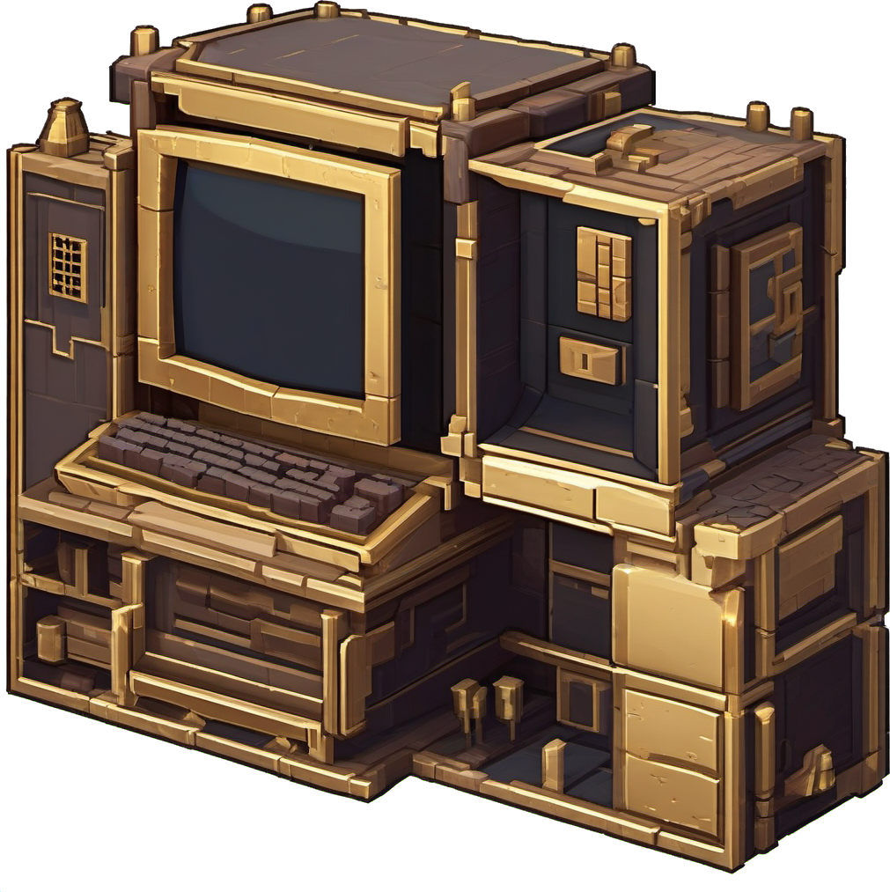

# TaleCraft



**Programmable Lua computers for Hytale** — a ComputerCraft-style server plugin: craft a
Computer block, press F, and you get a real terminal running **TaleOS**, a small Lua OS,
sandboxed and safe for multiplayer servers.

> Early Access project, built for Hytale server 0.6.2 (Java 25). Server-side plugin: players
> only need the vanilla client (assets are delivered by the server).

## Features (v0.1)

- **Computer block** (craft at the Workbench: 4 copper bars + 4 deadwood planks) with its own
  voxel model, palette texture, and a boot beep.
- **Terminal UI**: press **F** on a Computer to open its terminal. Type commands, press Enter.
- **TaleOS**: line shell with programs `id`, `ls`, `cat`, `mkdir`, `rm`, `echo`, `lua`
  (mini-REPL), `edit` (line editor: `.save` / `.abort`), `reboot`, `shutdown`.
- **Sandboxed Lua runtime** (LuaJ): per-tick instruction budget — an infinite loop (even inside
  `pcall`/`xpcall` or child coroutines) kills the script, never the server.
- **Per-computer filesystem**: jailed, 1 MB quota, persists across restarts
  (`mods/TaleCraft/computers/<id>/`). Read-only `rom/` with TaleOS.
- **World API v1**: `tale.getBlock(dx,dy,dz)`, `tale.detect(...)`, `tale.chat(msg)`,
  `tale.time()` — executed safely on the tick thread.
- **Monitor block**: place next to a running Computer and press F to mirror its terminal
  (read-only).

## Lua quick start

Open a terminal and try:

```
lua
> fs.write('hello.txt', 'persisto')
> exit
cat hello.txt
reboot
```

Then `cat hello.txt` again after a server restart — files survive.

## Safety notes for server owners

- Scripts cannot touch Java (`luajava`, `io`, `debug`, `package` are removed; `os` is reduced
  to `clock/time/date`).
- Instruction budget per tick (default 200k bytecodes) with an uncatchable kill.
- World reads only work on loaded chunks and are rate-limited per tick.
- No network access from Lua.

## For developers

```bash
./gradlew build          # fat jar with LuaJ embedded -> build/libs/talecraft-*.jar
./gradlew test           # 25+ headless tests (runtime, sandbox, fs, TaleOS boot)
python tools/generate_assets.py   # regenerates models/textures/sound (needs numpy, Pillow, soundfile)
```

The Hytale server jar is resolved via the `hytale_home` property (see `gradle.properties`).
`-Dtalecraft.selftest=true` runs a headless in-server smoke test at startup (boot to prompt,
stdin command, budget kill).

## License and credits

TaleCraft is **MPL-2.0** (see `LICENSE`). It is a clean-room reimplementation inspired by
ComputerCraft/CC:Tweaked — no code or assets were copied. See `CREDITS.md`.
