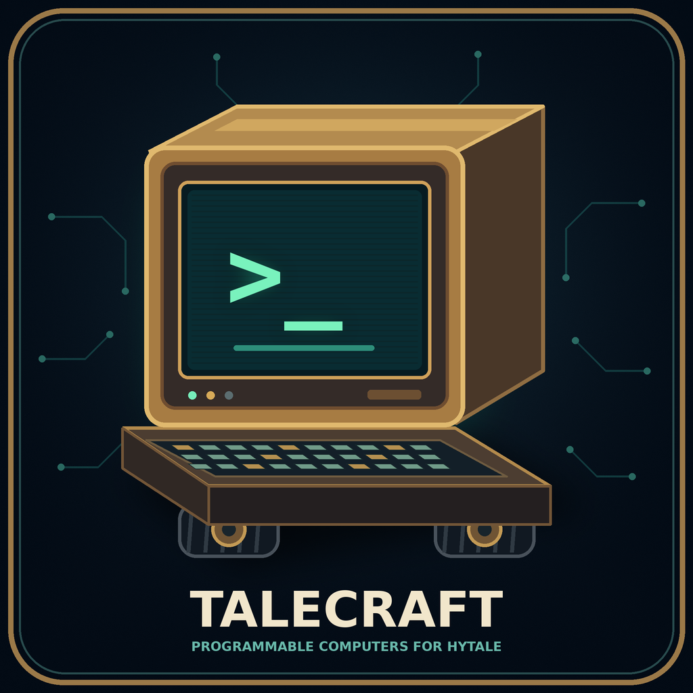

# TaleCraft



**Programmable Lua computers for Hytale** — a ComputerCraft-style server plugin: craft a
Computer block, press F, and you get a real terminal running **TaleOS**, a small Lua OS,
sandboxed and safe for multiplayer servers.

> Early Access project, built for Hytale server 0.6.2 (Java 25). Server-side plugin: players
> only need the vanilla client (assets are delivered by the server).

## Installation

1. Download `talecraft-0.1.0.jar` from
   [GitHub Releases](https://github.com/SergioAtienzaPastor/TaleCraft/releases/latest).
2. Copy it into the server's `Server/mods/` directory.
3. Restart the Hytale server. No client-side installation is required.

## Features (v0.1)

- **Computer block** (craft at the Workbench: 4 copper bars + 4 deadwood planks) with its own
  voxel model, palette texture, and a boot beep.
- **Terminal UI**: press **F** on a Computer to open its terminal. Type commands, press Enter.
  Lua programs can use a 51×19 character grid, cursor, scrolling, 16-color `blit`,
  clipped `window.create` surfaces and `term.redirect`; the shell keeps its scrollable transcript.
- **TaleOS**: line shell with programs `id`, `ls`, `cd`, `cat`, `mkdir`, `rm`, `echo`, `lua`
  (mini-REPL), `edit` (visual editor), `wget`, `reboot`, `shutdown`. Commands and Lua filesystem
  paths resolve from the shell's current directory; `cd ..` and absolute `/...` paths are supported.
- **Sandboxed Lua runtime** (LuaJ): per-tick instruction budget — an infinite loop (even inside
  `pcall`/`xpcall` or child coroutines) kills the script, never the server.
- **Events and cooperative tasks**: typed `os.queueEvent`/`os.pullEvent`, tick-based cancelable
  timers, `parallel.waitForAny`/`waitForAll`, and automatic execution of the computer's
  `startup.lua` before the shell (also after reboot).
- **Per-computer filesystem**: jailed, 1 MB quota, persists across restarts
  (`mods/TaleCraft/computers/<id>/`). Read-only `rom/` with TaleOS.
- **World API v1**: `tale.getBlock(dx,dy,dz)`, `tale.detect(...)`, `tale.chat(msg)`,
  `tale.time()` — executed safely on the tick thread.
- **Peripherals**: discover adjacent devices with `peripheral.getNames/wrap/find`, receive
  attach/detach events, inspect chests and other item containers, and use monitors through
  the same API. Turtles can `suck*`/`drop*` directly from/to adjacent containers.
- **Wireless networking**: craft a Modem (4 copper bars + 1 deadwood plank) and place it next
  to a Computer. `rednet` supports channels, protocols, broadcast, timeouts and DNS; `gps.locate`
  resolves positions from at least four non-coplanar reference hosts. Messages are deep-copied
  and bounded, and only reach loaded receivers in the same world and within range.
- **Configurable HTTP downloads**: `http.get(url)` and `wget <url> [file]` work on Computers and
  Turtles without blocking server ticks. Downloads are saved, never executed automatically.
- **Monitor block**: programs draw colored pixels and text directly on the block in the world;
  there is no F/page interface. Compatible monitors form shared rectangles up to 8×8 blocks,
  preserve their content on resize/split and emit `monitor_resize`; every block renders its own
  crop of the shared canvas.
- **PenDrives and USB drives**: insert a `TaleCraft_PenDrive` into a `TaleCraft_USB_Drive`
  to mount persistent files at `usb`, `usb2`, etc. IDs, labels and 1 MB quotas are independent
  per medium. The `usb_drive` peripheral supports labels, mount paths and safe ejection.
- **Stackable NAS**: each `TaleCraft_NAS` holds 8 PenDrives. Connected units share their media
  with every running Computer/Turtle/Pocket within 16 blocks, using stable `nas/<id>` paths. The same
  files can be read or executed by several machines and a PenDrive cannot be inserted twice.
- **Speakers**: place a `TaleCraft_Speaker` or equip it on a Turtle and call
  `playSound(name[, volume[, pitch]])` with any registered SoundEvent. Sounds are positional
  and rate-limited; arbitrary audio streaming is not included.
- **Pocket Computer**: use a `TaleCraft_PocketComputer` item to open a mobile terminal.
  Files and identity persist, while execution suspends when the item is dropped, its holder
  disconnects or changes worlds. Nearby NAS media follows the player and is unmounted on suspension.
  Duplicate stacks cannot run two sessions on the same disk.
- **Turtle robot** (6 copper bars + 2 deadwood planks): a movable computer with a 4×4
  inventory and two filtered upgrade slots. Its page combines the terminal, item icons,
  player inventory, selected-slot highlight and upgrade controls. Left/right tools and weapons
  appear as native 3D geometry on the chassis and swing when used. Movement preserves the
  running program, computer ID, files, inventory and equipped upgrades.
- **Turtle Lua API**: movement/turning, detection/inspection, digging/placement,
  `attack*`/`craft`, `suck*`/`drop*`, comparison, inventory queries/transfers,
  `equipLeft`/`equipRight`, `getEquippedLeft`/`getEquippedRight`, and unlimited-fuel queries.
  Actions return `true` or `false, reason`. ROM programs include `go`, `turn`, `tunnel`,
  `excavate`, `equip` and `unequip`. `tunnel N` digs a 3×3 cross-section. Slots are numbered
  1–16 from Lua; tools must be appropriate for the block being mined. Equipped tools and weapons
  do not lose durability when the Turtle uses them. Modems and the `TaleCraft_Crafting_Upgrade`
  can occupy either upgrade slot; crafting supports ordinary
  tier-0 Crafting recipes and preserves inventory/metadata when planning its output.

## Lua quick start

Open a terminal and try:

```
lua
> fs.write('hello.txt', 'persisto')
> exit
cat hello.txt
reboot
```

Then `cat hello.txt` again after a server restart — files survive.

## Safety notes for server owners

- Scripts cannot touch Java (`luajava`, `io`, `debug`, `package` are removed; `os` is reduced
  to `clock/time/date`).
- Instruction budget per tick (default 200k bytecodes) with an uncatchable kill.
- World reads only work on loaded chunks and are rate-limited per tick. With no players
  nearby a computer's chunk unloads and `tale.detect`/`getBlock` return false/nil (same
  rule as CC:T). To keep an area running use vanilla keep-loaded:
  `/world settings keeploaded set <minX> <minZ> <maxX> <maxZ> --world=<mundo>`.
- HTTP is asynchronous and limited to GET text requests. Timeouts, response-size limits, per-computer
  concurrency and global download bandwidth are enforced. Redirects are validated again.

### HTTP configuration

The server creates `mods/TaleCraft/config.json` on startup; restart after editing it. The default
configuration enables HTTP, allows 16 concurrent requests per computer, uses a 30-second timeout,
allows 16 redirects, limits each download to 16 MiB and global download throughput to 32 MiB/s.
`max_requests = 0` removes the per-computer concurrency limit.

Rules are checked in order and the first match wins. The defaults deny `$private` (loopback, LAN,
link-local, reserved IPv4/IPv6 ranges and similar addresses) and allow other hosts:

```json
{
  "http": {
    "enabled": true,
    "rules": [
      { "host": "$private", "action": "deny" },
      { "host": "*", "action": "allow", "max_download": 16777216 }
    ]
  }
}
```

The complete generated file also contains the timeout, redirect, concurrency and bandwidth settings.
Domains, IPs, wildcards such as `*.example.com` and CIDR ranges are supported. DNS results and every
redirect destination are checked. Invalid configuration fails closed. Set `http.enabled` to `false`
to remove the API. POST, WebSockets, proxies and Git cloning are not included yet.

The same file contains `modem.range` (default 64) and `modem.max_messages_per_tick`
(default 32), both limited to 1–256.

Example using a GitHub Raw URL:

```text
wget https://raw.githubusercontent.com/user/repository/main/program.lua program.lua
program
```

### Console/admin command

`/talecraft <mundo> <x> <y> <z> <línea de shell>` boots the computer at that block (if
needed) and queues one shell line — scriptable from the server console for tests and
admin work. `/talecraft <mundo> <x> <y> <z> __probe` logs chunk/section diagnostics.
Every computer also writes a transcript to `mods/TaleCraft/logs/computer-<id>.log`.

## For developers

```bash
./gradlew build          # fat jar with LuaJ embedded -> build/libs/talecraft-*.jar
./gradlew test           # 25+ headless tests (runtime, sandbox, fs, TaleOS boot)
python tools/generate_assets.py   # regenerates models/textures/sound (needs numpy, Pillow, soundfile)
```

The Hytale server jar is resolved via the `hytale_home` property (see `gradle.properties`).
`-Dtalecraft.selftest=true` runs a headless in-server smoke test at startup (boot to prompt,
stdin command, budget kill).

## License and credits

TaleCraft is **MPL-2.0** (see `LICENSE`). It is a clean-room reimplementation inspired by
ComputerCraft/CC:Tweaked — no code or assets were copied. See `CREDITS.md`.
